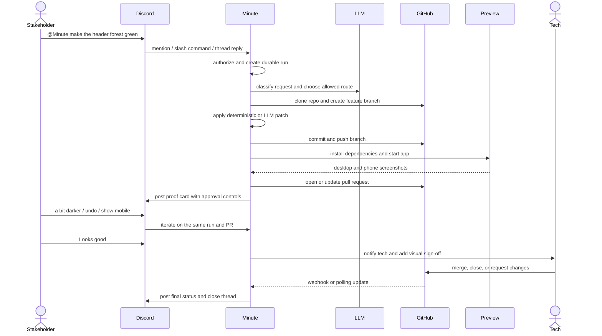
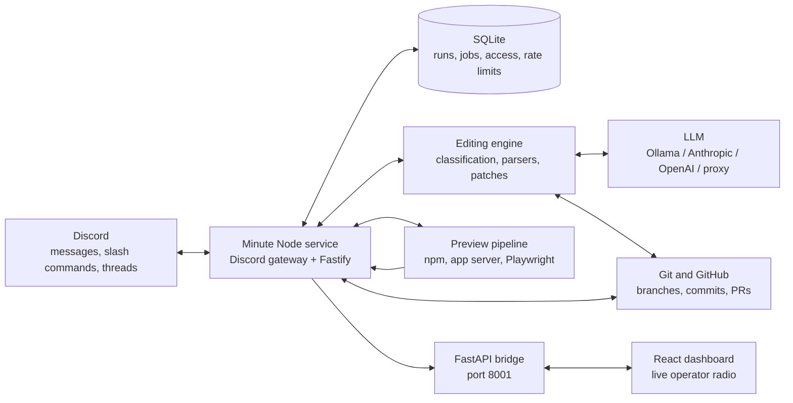
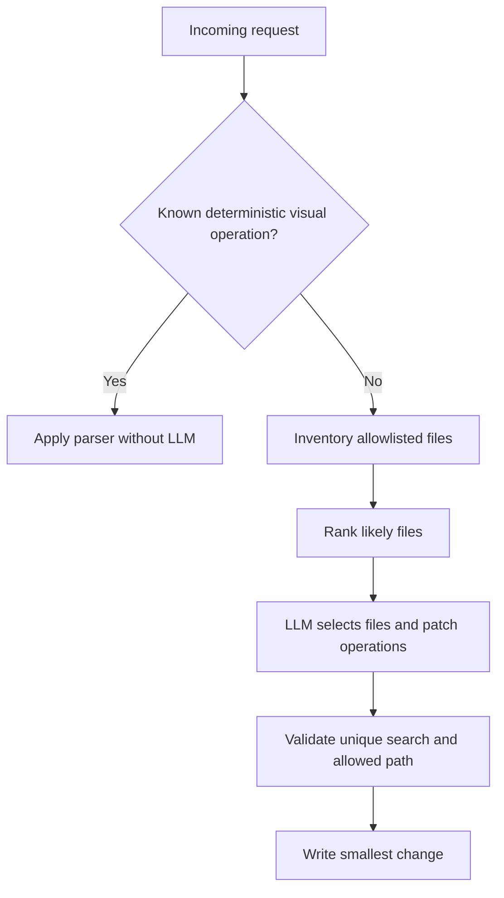

# Minute

<p>
  <b>Talk in Slack. See the change. Approve it. Let tech review the PR.</b>
</p>

<p>
  <a href="#quick-start">Quick start</a> |
  <a href="#architecture">Architecture</a> |
  <a href="#end-to-end-workflow">Workflow</a> |
  <a href="#technology-stack">Tech stack</a> |
  <a href="#project-map">Project map</a> |
  <a href="#testing">Testing</a>
</p>

> Minute is a Slack-driven visual handoff system. A stakeholder describes a small change or supplies a reference, Minute edits an isolated Git branch, starts the app, captures a real desktop and mobile screenshot, and opens or updates a pull request.

## See the loop



<details open>
  <summary><b>Try these interactions</b></summary>

| You say | Minute does |
|---|---|
| `@Minute make the header forest green` | Applies a small visual edit and returns a proof photo |
| `A bit darker` | Reuses the last visual operation and updates the same PR |
| `Bigger type` | Adjusts the detected target type size |
| `Hide the badge` | Hides the named element |
| `Say Welcome back instead` | Replaces visible copy |
| `Show me mobile` | Restamps the phone screenshot |
| `Undo that` | Reverts the last Minute commit |
| `Looks good` | Signs off visually and pings tech |
| `Cancel` | Stops the run and locks the thread |

You can also drop:

- **A PNG/JPG/WEBP** to match as a visual reference.
- **A PDF/DOC/TXT/Markdown file** to read as a specification.
- **An SVG/ICO/font** to place as a product asset.

</details>

---

## What problem does it solve?

Minute removes the translation gap between someone with visual intent and an engineer reviewing code.

| Role | Owns |
|---|---|
| Stakeholder | Intent, visual comparison, sign-off |
| Minute | Small scoped edit, branch, preview, proof, PR description |
| Tech | Technical feasibility, code review, merge decision |

Minute does **not** attempt architecture, authentication, billing, infrastructure, migrations, secrets, rewrites, or new product flows. It refuses those requests and leaves the work to a person.

<details>
  <summary><b>Read the product principles</b></summary>

- The photo is the visual specification.
- Git stays out of the stakeholder workflow.
- Each change stays inside explicitly allowed repository paths.
- Every successful run proves the edited branch.
- The PR describes the diff, not the Discord chat transcript.
- Sign-off is visual; merge decision is still made by tech.
- Deterministic edits run before the LLM.
- Human handoff is preferable to a risky generated change.

See [FIRST_PRINCIPLES.md](FIRST_PRINCIPLES.md) and [memory/PRD.md](memory/PRD.md).

</details>

---

## Architecture



### Repository map

| Directory | Role | Key technology |
|---|---|---|
| [`minute/`](minute/) | Main production product | Node 22, TypeScript, discord.js, Fastify, Octokit, simple-git, Playwright |
| [`backend/`](backend/) | Optional LLM/dashboard bridge | Python, FastAPI, Pydantic, HTTPX |
| [`frontend/`](frontend/) | Read-only operator dashboard | React 19, CRACO, Axios, Tailwind CSS |
| [`ad/`](ad/) | Static promotional/download website | HTML, CSS, JavaScript, video, Vercel config |
| [`test_reports/`](test_reports/) | Saved test evidence | Pytest XML and JSON reports |
| [`memory/`](memory/) | Product requirements and build log | PRD and historical decisions |

---

## Technology stack

<details open>
  <summary><b>Main bot</b></summary>

| Tool | Purpose |
|---|---|
| Node.js 22 | Bot runtime |
| TypeScript / tsx | Type-safe implementation and direct TypeScript execution |
| discord.js | Discord gateway, slash commands, threads, embeds, modals, buttons |
| Fastify | HTTP health, readiness, internal dashboard, and webhook endpoints |
| Node SQLite | Durable runs, jobs, access overlay, and rate-limit storage |
| Octokit | GitHub API operations |
| simple-git | Clone, branch, commit, push, diff, and undo operations |
| Zod and YAML | Configuration schemas and YAML loading |
| Pino | Structured logging |

</details>

<details>
  <summary><b>Editing and preview</b></summary>

| Tool | Purpose |
|---|---|
| Ollama | Default local open-source LLM backend |
| Anthropic SDK | Optional Claude backend |
| OpenAI SDK | Optional GPT backend |
| FastAPI proxy | Optional shared LLM proxy |
| Playwright / Chromium | Desktop and phone proof screenshots |
| npm | Preview dependency installation |
| GitHub PAT | Repository and pull request access |

</details>

<details>
  <summary><b>Dashboard and static site</b></summary>

| Tool | Purpose |
|---|---|
| React 19 | Dashboard interface |
| CRACO | CRA and alias/build customization |
| Tailwind CSS | Dashboard styling support |
| Axios | Dashboard API requests |
| React Query / SWR | React data infrastructure |
| Radix UI / Shadcn-style components | UI primitives and generated components |
| FastAPI | Dashboard bridge and Ollama completion API |
| Vercel config | Static marketing-site deployment redirects and caching |

</details>

---

## End-to-end workflow

### 1. Start a run

Minute accepts a mention, `/minute` slash command, or an attachment .

```text
@Minute make the header forest green
```

Minute:

1. Verifies Discord channel and requester access.
2. Applies Discord and per-user rate limits.
3. Creates a public thread.
4. Creates a run in SQLite.
5. Enqueues a durable `start` job.

### 2. Classify safely

The request is checked against:

- Allowed routes.
- Allowed repository paths.
- Hard refusal topics.
- Attachment roles.
- Request size and complexity limits.

Simple visual requests can bypass the LLM. Complex-but-small requests use an LLM JSON gate.

### 3. Edit safely

Minute prefers this order:



The patch layer rejects:

- Path traversal.
- Paths outside `allow.paths`.
- `.git` changes.
- Multiple ambiguous search matches.
- Oversized files.
- More than four edited files.

### 4. Create a Git branch

Minute:

1. Clones the configured repository.
2. Creates a run-specific branch.
3. Commits with `minute:` in the subject.
4. Pushes the branch.
5. Opens a new PR or updates the existing PR.

The PR title and body describe the diff, changed files, route, proof, and visual sign-off state.

### 5. Capture proof

The preview pipeline:

1. Installs dependencies.
2. Allocates a localhost port.
3. Starts the configured app command.
4. Waits for an actual usable route.
5. Dismisses simple cookie banners.
6. Captures a desktop screenshot.
7. Resizes Chromium to phone dimensions and captures again.

If preview boot fails, Minute keeps the code/PR and posts an explicit photo failure reason instead of posting a fake screenshot.

### 6. Iterate in the thread

Minute supports a shared run state, so follow-ups update the same branch and PR:

```text
A bit darker
      ↓
repeat last visual operation
      ↓
commit
      ↓
force-update the branch
      ↓
update PR
      ↓
new proof card
```

### 7. Sign off or exit

On `Looks good`:

- Minute updates the PR with visual sign-off.
- The proof card is restamped.
- Configured tech users are pinged.
- The thread is locked.
- The workspace is pruned.

Tech can then approve, merge, close, or request changes on GitHub. Minute detects merge/close/review changes through webhooks and polling, posts the final state, and stops iterating.

---

## Project map

<details open>
  <summary><b>Main runtime modules</b></summary>

| File | Responsibility |
|---|---|
| [`minute/src/index.ts`](minute/src/index.ts) | Process boot, probes, HTTP server, shutdown |
| [`minute/src/discord-app.ts`](minute/src/discord-app.ts) | Discord gateway events and commands |
| [`minute/src/protocol.ts`](minute/src/protocol.ts) | Central tweak, scratch, ask, handoff, cancel, and undo flow |
| [`minute/src/queue.ts`](minute/src/queue.ts) | Durable job worker and retry logic |
| [`minute/src/store.ts`](minute/src/store.ts) | SQLite run and PR lookup |
| [`minute/src/config.ts`](minute/src/config.ts) | Zod configuration parsing |
| [`minute/src/agent.ts`](minute/src/agent.ts) | LLM-assisted smallest patch engine |
| [`minute/src/simple-edit.ts`](minute/src/simple-edit.ts) | Deterministic visual language parsing |
| [`minute/src/patch.ts`](minute/src/patch.ts) | Safe unique search/replace patch application |
| [`minute/src/paths.ts`](minute/src/paths.ts) | Repository path allowlisting |
| [`minute/src/git.ts`](minute/src/git.ts) | Git clone, branch, commit, push, diff, undo |
| [`minute/src/github.ts`](minute/src/github.ts) | Octokit PR and repository operations |
| [`minute/src/preview.ts`](minute/src/preview.ts) | App boot and Playwright screenshots |
| [`minute/src/ask.ts`](minute/src/ask.ts) | GitHub repository Q&A |
| [`minute/src/scratch.ts`](minute/src/scratch.ts) | New-project templates |
| [`minute/src/attachments.ts`](minute/src/attachments.ts) | Mock/spec/asset classification |

</details>

<details>
  <summary><b>Configuration and data</b></summary>

[`minute/minute.config.yaml`](minute/minute.config.yaml) is the operation rail sheet. It selects:

- Admin/requester/tech identities.
- Discord channel-to-repository mappings.
- Preview command and route.
- Repository allowlist.
- Refused topics.

[`minute/.env.example`](minute/.env.example) documents environment variables. Secrets should be provided through `.env`, deployment secrets, or a secret manager.

</details>

---

## Quick start

### Prerequisites

- Node.js 22+
- npm
- Git
- Slack bot token, app-level token, and signing secret (Socket Mode)
- GitHub PAT with repository and pull-request write access
- Ollama or another supported LLM backend
- Playwright Chromium

### 1. Start Ollama

```bash
ollama serve
ollama pull qwen2.5-coder:7b
```

### 2. Configure and start Minute

```bash
cd minute
cp .env.example .env
npm install
npx playwright install chromium
```

Edit:

- [`.env`](minute/.env.example) — credentials and runtime settings.
- [`minute.config.yaml`](minute/minute.config.yaml) — channels, repositories, preview, and allowlist.

Start Minute:

```bash
npm start
```

Slack uses Socket Mode. Put `SLACK_BOT_TOKEN` (`xoxb-`), `SLACK_APP_TOKEN` (`xapp-`), and `SLACK_SIGNING_SECRET` in `.env`, then invite the app and run `/minute` in a channel listed under `slackChannelIds`.

Useful commands:

```bash
npm run typecheck
npm test
npm run ci
npm run check:ready
```

### 3. Start the optional dashboard bridge

```bash
cd backend
pip install -r requirements.txt
uvicorn server:app --port 8001
```

### 4. Start the React dashboard

```bash
cd frontend
npm install
npm start
```

Set `REACT_APP_BACKEND_URL` to the FastAPI public or local API URL.

### Slack setup checklist

- Create the app at [api.slack.com/apps](https://api.slack.com/apps) and turn on **Socket Mode**.
- Bot scopes: `chat:write`, `commands`, `files:write`, `files:read`, `channels:history`, `groups:history`, `app_mentions:read`, `users:read`.
- Bot events: `app_mention`, `message.channels`, `message.groups`.
- Slash commands: `/minute` and `/minute-admin`.
- Add the Slack channel id and member ids to `minute.config.yaml`.

---

## Docker deployment

The main service includes Docker support:

```bash
cd minute
docker compose up --build
```

Persistent data is mounted in a Docker volume:

- SQLite database.
- Jobs and run state.
- Preview caches.
- Npm cache.

The container:

- Uses the Playwright Noble image.
- Runs Node 22.
- Stores data in `/app/.data`.
- Exposes port `8787`.
- Performs a `/health` Docker health check.
- Cleans preview processes during shutdown.

---

## Testing

<details open>
  <summary><b>Node unit and photo tests</b></summary>

- Path traversal and allowlist checks.
- Unique patch application.
- SQLite run state and claiming.
- English turn parsing.
- Attachment classification.
- Signed button authorization.
- PR description generation.
- Preview compile/404 detection.
- Discord proof cards.
- Deterministic visual edits.
- Repository Ask behavior.
- Scratch templates.
- Real Chromium desktop and mobile screenshot capture.

</details>

<details>
  <summary><b>FastAPI tests</b></summary>

The backend tests cover:

- Ollama health.
- LLM completion.
- System prompt support.
- Pydantic request validation.
- Minute overview bridge.
- Recent run bridge.

</details>

<details>
  <summary><b>CI</b></summary>

[minute/.github/workflows/ci.yml](minute/.github/workflows/ci.yml) runs on pushes and pull requests:

1. Node 22 setup.
2. npm dependencies.
3. Playwright Chromium install.
4. TypeScript typecheck.
5. Node tests.

</details>

---

## State and limits

The system uses SQLite for:

- Runs.
- Jobs.
- Access grants.
- Rate-limit events.
- GitHub webhook delivery deduplication.

Default limits:

| Limit | Value |
|---|---|
| Request length | 4,000 characters |
| Tweaks per run | 8 |
| Starts per user/hour | 10 |
| Iterations per user/hour | 30 |
| Concurrent jobs | 2 |
| Edited files per operation | 4 |
| File edit size | 200 KB |
| Attachments per request | 4 |
| Attachment size | 8 MB |
| Job timeout | 15 minutes by default |

---

## Production direction

The next production milestones are:

1. Replace PAT authentication with a GitHub App.
2. Move the worker to a hosted queue and persistent database.
3. Require GitHub webhooks and add webhook secrets.
4. Extend tests around real Discord and GitHub write flows.
5. Add stronger app sandboxing.
6. Improve preview readiness detection.
7. Expand destructive-action and audit protections.
8. Add per-office cost and usage reporting.

For detailed product direction, see [FIRST_PRINCIPLES.md](FIRST_PRINCIPLES.md).
