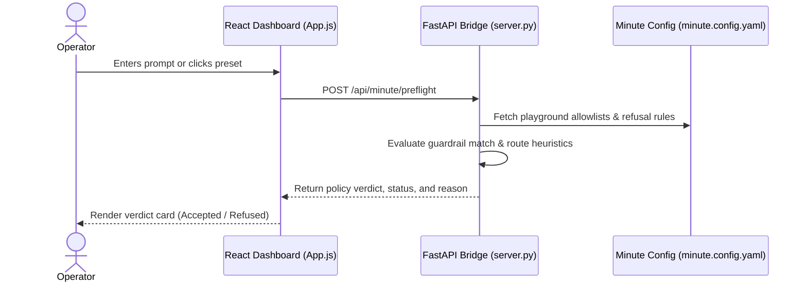

# Workflow Pre-Flight Policy Simulator

The **Workflow Pre-Flight Policy Simulator** is an operator-facing safety and dry-run feature for Minute. It enables developers, operators, and technical reviewers to test, validate, and simulate stakeholder change requests against playground security policies before any message is sent in Discord or any Git branch is touched.

---

## What Problem It Solves

Minute operates on strict first principles:
- It only handles simple visual changes (copy, color, spacing, asset placement, layout).
- It strictly refuses architectural changes, authentication, billing, migrations, infrastructure, secrets, and rewrites.
- Every change is bounded by explicit repository path allowlists and preview routes.

Previously, verifying whether a stakeholder request would be accepted or refused required posting a live message into Discord and awaiting bot execution. 

The **Workflow Pre-Flight Policy Simulator** adds an instant sandbox layer:
1. Operators can dry-run any prompt directly in the Operator Dashboard.
2. It tests against all configured guardrails (`minute.config.yaml` refusals and path allowlists).
3. It displays the exact spoken response and policy status that Minute would provide to stakeholders in Discord.

---

## What Was Added

### 1. Interactive Operator Dashboard Sandbox (`frontend/src/App.js`, `frontend/src/App.css`)
- **Pre-Flight Simulator Widget**: Integrated directly into the main operator dashboard below the playground and access controls.
- **One-Click Scenario Presets**:
  - `🎨 Visual: Green Header`: Simulates a valid visual styling adjustment.
  - `🚫 Refusal: Stripe Billing`: Tests payment and billing keyword guardrails.
  - `🔒 Refusal: OAuth Auth`: Tests authentication and security refusal rules.
  - `📱 Viewport: Mobile`: Tests layout and viewport route targeting.
- **Live Visual Feedback**:
  - Instant status badge: `ACCEPTED` (green) or `REFUSED` (red).
  - Scope classification: `visual_tweak`, `general_edit`, or `hard_refusal`.
  - Target route resolution (e.g. `/`).
  - Exact human-readable explanation generated for Discord.
  - Highlighted tags indicating which guardrails triggered a refusal.

### 2. Playground Policy Introspection
- Updated `minute/src/overview.ts` to export playground `refuse` keywords and `allowRoutes` alongside existing path allowlists.
- Playground cards in the dashboard now visually display the enforced safety refusals (`auth`, `payments`, `billing`, `migrations`, `infrastructure`, etc.) alongside allowed directories.

### 3. FastAPI Policy Engine Endpoint (`backend/server.py`)
- Added `POST /api/minute/preflight`:
  - Request body: `{ "request": string, "playground_id"?: string }`
  - Validates the prompt against playground refusal keywords and bounds.
  - Detects visual intent heuristics (`color`, `header`, `button`, `spacing`, `dark`, `hide`, etc.).
  - Returns structured diagnostics: `ok`, `status`, `reason`, `matched_refusals`, `route`, `allowed_paths`, and `category`.

### 4. Automated Backend Test Suite (`backend/tests/backend_test.py`)
- Added `TestPreflight` covering:
  - Acceptance of valid visual requests (`test_preflight_allowed_visual_request`).
  - Rejection of restricted scopes like auth/payments/migrations (`test_preflight_refused_restricted_scope`).
  - Validation error handling for empty requests (`test_preflight_validation_error`).

---

## Architectural Flow



---

## How to Run and Test

1. **Start the FastAPI Bridge**:
   ```bash
   cd backend
   pip install -r requirements.txt
   uvicorn server:app --port 8001
   ```

2. **Run the Pre-Flight Tests**:
   ```bash
   cd backend
   pytest tests/backend_test.py -k TestPreflight
   ```

3. **Open the Operator Dashboard**:
   ```bash
   cd frontend
   npm install
   REACT_APP_BACKEND_URL=http://localhost:8001 npm start
   ```
   Navigate to the **Workflow Pre-Flight Simulator** card to test prompts interactively.
